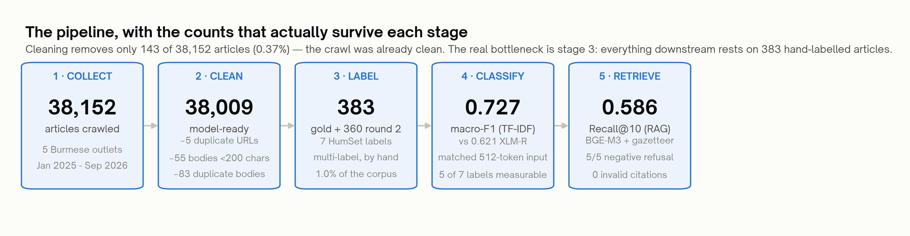
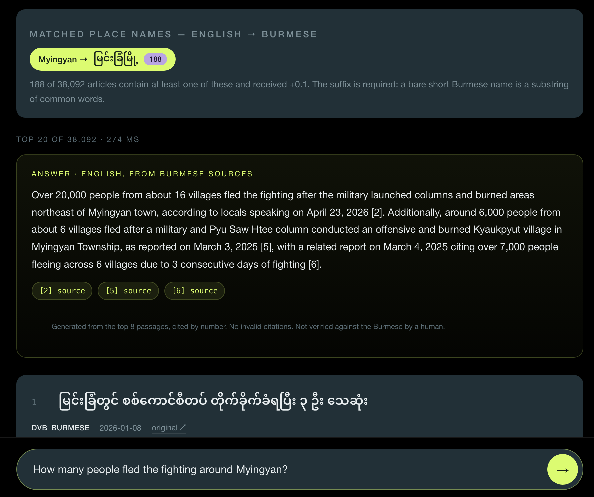

# MyHumNews: Reading Myanmar in Burmese

Ask Burmese news questions in English and get answers that cite the original Burmese
articles, with no translation step. Also: a 134,667-article Burmese news dataset and
classifiers that tag articles with humanitarian and newsroom topic labels.

BDAPP course project, Fall 2026, Sejong University (Prof. Mugahed A. Al-antari).
Author: Zwe Htet Aung.



## Why

Since the 2021 coup, most first-hand reporting on airstrikes, displacement and casualties
in Myanmar is written in Burmese. Most international crisis responders don't read it.
This project tests whether an English question can find and answer from Burmese news
directly.

## What's in this repo

| Part | What it does | Main code |
|---|---|---|
| **1. Dataset** | Crawls 5 Burmese outlets (DVB, RFA, The Irrawaddy, BBC Burmese, Myanmar Now), cleans and deduplicates them, maps newsroom tags onto 20 topic labels | `crawler/`, `run.py`, `dataset/` |
| **2A. Humanitarian classifier** | Tags articles with 7 HumSet-style labels, trained on 383 hand-labelled articles | `classifier/` |
| **2B. Topic classifier** | Tags DVB articles with 19 newsroom desks; TF-IDF vs XLM-R on 62k articles | `dataset/` |
| **3. Cross-lingual RAG** | English question → BGE-M3 search over Burmese articles + a place-name gazetteer → Gemini answer with citations | `rag/`, `ui/` |

## Results

All numbers are measured and can be re-run; details in [`docs/WORKLOG.md`](docs/WORKLOG.md).

**Humanitarian classifier** (7 labels, 383 gold articles, macro-F1 on labels with ≥20 examples)

| Setup | TF-IDF + LinearSVC | XLM-R (3 seeds) |
|---|---|---|
| Gold only, same 512 tokens | **0.727** | 0.621 |
| + 180 targeted hand-labelled articles | 0.732 | 0.661 |

Adding 16,087 rule-based weak labels made TF-IDF worse (0.755 → 0.702, full text).

**Topic classifier** (19 DVB desks, train ≤2024, test 2025+, 62,016 articles)

| Model | Macro-F1 |
|---|---|
| TF-IDF + LinearSVC, same 512 tokens | 0.643 |
| XLM-R base | **0.672** (wins 16 of 19 desks) |

Low-scoring desks are often ones DVB itself labels inconsistently: across 13,283
near-identical story pairs, label agreement tracks model F1 at r = 0.874.

**Retrieval** (38,092 articles, 2025 onward, 29 known-item questions)

| Method | R@1 | R@5 | R@10 | MRR |
|---|---|---|---|---|
| BGE-M3 dense | 0.207 | 0.414 | 0.517 | 0.310 |
| + 54-place Burmese gazetteer | **0.276** | **0.483** | **0.586** | **0.391** |
| Chunked index (rejected) | 0.103 | | | |

Translated names (NUG, WFP) match their Burmese well; names written by sound
(Mandalay, Myingyan) don't, which is what the gazetteer fixes.

**Answers** (Gemini free tier, top 8 passages, 49 questions)

- 5 of 5 out-of-scope questions refused, with no citations
- 0 of 16 false refusals when the right article was retrieved; all 16 cited it
- 0 invalid citations



## Limitations

- **Faithfulness is not hand-checked yet.** 12 answers were written without the right
  article retrieved; whether they match the Burmese still needs a human check.
- **Small evals.** 29 retrieval questions, 5 negatives, 3 XLM-R seeds. Trust the direction
  more than the exact size.
- **Two thin labels.** `humanitarian_access` (16 gold examples, annotator κ 0.091) and
  `information_communication` (6) are flagged low confidence and kept out of search filters.
- **Scope.** The humanitarian gold set and the search index cover 2025–2026 only.
  Labels for 2021–2024 are model predictions that haven't been checked yet.
- **First 512 tokens.** Both XLM-R and the search index read only the start of each article.

## Setup

Python 3.13 and [uv](https://docs.astral.sh/uv/).

```bash
uv sync
cp .env.example .env        # add a free Gemini API key for answer generation
```

The corpus, the search index and the labels are not in this repo (see [Data](#data)).

## Usage

```bash
# Crawl one outlet (resumable; Ctrl-C and rerun at any time)
.venv/bin/python run.py bbc run --limit 20

# Train the humanitarian classifier and label a corpus
.venv/bin/python -m classifier.predict_corpus --corpus-jsonl dataset/myhumnews.jsonl \
    --out classifier/data/corpus_labels_full.jsonl

# Build the search index (BGE-M3, ~512 tokens per article)
.venv/bin/python -m rag.build_index --data data-vm --out rag/index

# Retrieval and answer evals
.venv/bin/python rag/eval/run_eval.py      # dense baseline
.venv/bin/python rag/eval/hybrid.py        # + gazetteer
.venv/bin/python rag/eval/eval_answers.py

# Search demo at http://127.0.0.1:8000
.venv/bin/python -m ui.serve --port 8000 --no-open
```

## Repository layout

```
crawler/, run.py      crawlers: one shared engine + one adapter per outlet
dataset/              dataset build, outlet crosswalk, DVB-19 topic classifier, dataset card
classifier/           HumSet 7-label classifier, labelling tools, annotation guide
rag/                  BGE-M3 embedding, index build, gazetteer, Gemini generation, evals
ui/                   search demo (stdlib server + one HTML page)
presentation/         slides, speaker notes, figures and the scripts that make them
docs/                 full work log and round-2 results
```

## Data

The articles belong to the five newsrooms, so no article text is in this repo. The dataset
(134,667 articles, Feb 2021 – Sep 2026, 20 topic labels; publisher labels and model
predictions kept in separate columns) is at
[`usagi-yojimbo/MyHumNews`](https://huggingface.co/datasets/usagi-yojimbo/MyHumNews) on
Hugging Face. It is private and gated while the publishers are being asked for permission.

## Credits

- Gold labels: 298 articles by Hsu Lin Htet, 85 by Zwe Htet Aung.
- Models: [XLM-RoBERTa](https://huggingface.co/FacebookAI/xlm-roberta-base),
  [BGE-M3](https://huggingface.co/BAAI/bge-m3), Gemini (free tier).
- Label scheme adapted from HumSet (Fekih et al., 2022).

## License

Code, annotations and label schemes: CC-BY-4.0. Article text is not covered and stays with
the publishers. See [`LICENSE`](LICENSE). To cite this work, see
[`CITATION.cff`](CITATION.cff).
