# MyHumNews Presentation Plan: Keynote-Style Redesign

**Course:** Big Data Application (BDAPP), Fall 2026, Sejong University  
**Student:** Zwe Htet Aung (23013124)  
**Instructor:** Prof. Mugahed A. Al-antari  
**Target Duration:** ~10 minutes (11–12 slides)  
**Design Aesthetic:** High-Impact Modern Keynote (Generous whitespace, bold typography in Grotesk, large hero metrics, high contrast lime `#DCFB71` on dark slate `#0e1418`, clean component hierarchy, zero walls of text).

---

## 1. Why the Previous Slides Felt "Ass" & The Core Fixes

| Problem in Previous Decks | Keynote-Grade Fix |
|---|---|
| **Wall of Text / Essay on Screen** | Every slide has **one primary claim** stated boldly. Max 3 bullets or a single focused comparison. Details live in the speaker notes. |
| **Boxy, Cluttered Cards** | Eliminate nested cards and borders. Use open space, clean grids, large contrast numbers (48–72px), and clear focal points. |
| **Disconnected Story Arc** | Ground the narrative directly in the **Topic Proposal**: Problem $\rightarrow$ The 134k Corpus $\rightarrow$ Tokenization Challenge $\rightarrow$ Classification at Small & Large Scale $\rightarrow$ Cross-Lingual RAG $\rightarrow$ Live Demo $\rightarrow$ Conclusion. |
| **Stiff Visuals** | Integrate updated Grotesk charts, clean metric hero units, and real query walkthroughs directly into the visual hierarchy. |

---

## 2. Visual & Typographic Design System

- **Canvas:** 16:9 widescreen (1600 × 900px, responsive scale to fit any display).
- **Background:** Deep slate `#0e1418` (matches the live UI and Otters inspiration).
- **Foreground Ink:** `#F0F4F6` (high readability off-white), secondary `#9AAEB7`.
- **Primary Accent:** `#DCFB71` (Lime — reserved strictly for key wins, matched entities, and hero metrics).
- **Secondary Accents:** `#B9A5E3` (Lilac — secondary metrics/provenance), `#4FA5FF` (Blue).
- **Typography:**
  - Headers / Numbers: **Hanken Grotesk / Space Grotesk** (Bold / ExtraBold, tight letter-spacing).
  - Body: **Hanken Grotesk / Sans-serif** (Clean, legible 20–22px, generous line-height 1.5).
  - Burmese Text: **Noto Sans Myanmar** (`line-height: 2.2` to preserve stacked diacritics).
  - Monospace / Metrics: **SF Mono / JetBrains Mono**.
- **Interactive Controls:**
  - Keyboard navigation (`←`, `→`, `Space`, `F` fullscreen, `N` speaker notes, (no theme toggle)).
  - Instant print/PDF export (`Cmd+P` outputs a pixel-perfect 16:9 PDF).

---

## 3. The 12-Slide Narrative Arc

```mermaid
flowchart LR
    A["1. The Premise"] --> B["2. HF Dataset"]
    B --> C["3. Dataset Labels"]
    C --> D["4. 512 Token Cliff"]
    D --> E["5. HumSet & Active Learning"]
    E --> F["6. DVB-19 at Scale"]
    F --> G["7. Annotation Ceiling"]
    G --> H["8. Transliteration Trap"]
    H --> I["9. Suffix Gazetteer"]
    I --> J["10. Grounded Generation"]
    J --> K["11. Live Azure Demo"]
    K --> L["12. Verified Conclusions"]
```

---

### Slide 1 — Title: Reading Myanmar in Burmese
- **Visual:** Minimalist hero layout. Giant bold title, course metadata, and 4 clean hero metric callouts.
- **Headline:** *Reading Myanmar in Burmese: Humanitarian Classification & Cross-Lingual RAG for People Who Don't Read Burmese.*
- **4 Key Stats:**
  - `134,667` Articles (Feb 2021 – Sep 2026, 5 Outlets; 372.7M characters)
  - `16 / 19` Desks Won by XLM-R (`0.672` Macro-F1 vs `0.643` linear; `0.821` Weighted-F1)
  - `0.586` R@10 Retrieval (Dense BGE-M3 + Suffix Gazetteer, zero translation)
  - `5/5 · 0` Refusals & citations (5/5 negatives refused, 0 invalid citations across 49 questions; hand faithfulness check open)

---

### Slide 2 — Deliverable 1: The Hugging Face Dataset
- **Visual:** 4 stat cards + a 4-step strip. Almost no prose.
- **Stat cards:** `134,667` articles (Feb 2021 – Sep 2026) · 5 outlets · `372.7M` characters (83.0% Burmese script) · 20 topic labels.
- **Strip:** Crawl (142,274 rows) $\rightarrow$ Deduplicate (−7,607 duplicate URLs) $\rightarrow$ Clean (HTML entities, UTC timestamps) $\rightarrow$ Publish (`usagi-yojimbo/MyHumNews`, private and gated).
- **Say out loud (notes only):** first crawl ~116k, final 134,667. This dataset is not the RAG index (38,092, 2025+), and its 20 labels are not the 7 HumSet labels.

---

### Slide 3 — Deliverable 1: Where the 20 Labels Come From
- **Visual:** One stacked bar + 3 short cards.
- **Bar:** 59.6% publisher-assigned (`topic_dvb19`) · 32.7% model-predicted (`topic_dvb19_predicted`) · 7.7% no label.
- **Cards:**
  - Crosswalk: 19 DVB desks + Human Rights; 14,377 labels recovered from Irrawaddy and BBC.
  - Distant supervision: trained on DVB only, thresholds set for 0.80 precision.
  - Honest limit: only 2 of 13 labels reach 0.80 on other outlets (prevalence shift). Predictions stay in their own column.
- **Source:** `dataset/DATASET_CARD.md`.

---

### Slide 4 — Deliverable 2: XLM-R Cannot Read 60% of Burmese Articles
- **Visual:** Token-cliff figure (`fig04_token_cliff.png`) + 2 stat cards.
- **Stats:** `60.1%` of articles cut at 512 tokens (230 of 383 gold) · `29.8%` of tokens thrown away (0.31 tokens/char).
- **Why it matters:** TF-IDF reads the whole article, so every linear baseline is also cut to the first 512 tokens (matched control).

---

### Slide 5 — Deliverable 2A: 383 Gold Articles, What Moved the Score
- **Visual:** 3 cards + 1 takeaway line. Macro-F1 on labels with ≥20 examples, same 512 tokens.
- **1 · Gold only:** TF-IDF `0.727` vs XLM-R `0.621` (3 seeds, sd 0.040).
- **2 · Weak labels:** 16,087 keyword labels, `0.755 → 0.702`. Dilution, not label noise.
- **3 · Targeted labels:** +180 articles, XLM-R `+0.040` vs TF-IDF `+0.005`; gap `0.106 → 0.071`.
- **Takeaway:** the gap was supervision, not architecture. Caveat: 3 seeds, paired p ≈ 0.16.
- **Source:** `docs/ROUND2_RESULTS.md`, README weak-supervision section.

---

### Slide 6 — Deliverable 2B: With 62k Articles, XLM-R Wins 16 of 19 Desks
- **Visual:** 2 stat cards + 5 gain bars. Temporal split: train ≤2024, test 2025+.
- **Split:** 62,016 articles = train 31,855 · val 5,622 · test 24,539.
- **Stats:** XLM-R macro-F1 `0.672` vs linear@512 `0.643`. COVID19 `0.818 → 0.124` (no COVID articles after 2024); excluding it `0.702`.
- **Gain bars (linear → XLM-R):** Environment +0.176 (0.867) · Education +0.143 (0.748) · Arts +0.130 (0.668) · Election +0.125 (0.771) · Women & Youth +0.108 (0.444).
- **Source:** `dataset/dvb_xlmr_result.json`.

---

### Slide 7 — Deliverable 2: Low Scores Often Mean the Labels Disagree
- **Visual:** Annotation-ceiling figure (`fig12_annotation_ceiling.png`) + 2 stat cards.
- **Near-duplicate check:** `r = +0.874` between newsroom agreement and model F1 (13,283 pairs). `social` agrees 15%, `ethnic` 18%.
- **Second annotator (50 articles, blind):** `humanitarian_access` κ `0.091`; casualties κ 0.691, context 0.500. Low-agreement labels get their own UI filter.
- **Caveat:** the model learned one annotator's conventions; this is not "beats a human".

---

### Slide 8 — Deliverable 3: Cross-Lingual Retrieval & The Transliteration Trap
- **Visual:** Big conceptual comparison: Translated Organizations vs. Transliterated Places.
- **The Finding:**
  - Dense BGE-M3 baseline achieves `R@1 0.207`, `R@10 0.517`.
  - **7 of 13 misses are geography swaps** (Myingyan $\rightarrow$ Kawkareik, Mandalay $\rightarrow$ Assam, Naypyitaw $\rightarrow$ Venezuela).
  - **Why:** Multilingual embeddings align *translated* semantic terms (`NUG 0.790`, `PDF 0.780`, mean `0.734`), but fail on phonetic *transliterations* (`Mandalay 0.403` loses to `Naypyitaw 0.440`!).

---

### Slide 9 — The Fix: Burmese Suffix Gazetteer & Retrieval Ceiling
- **Visual:** Formula callout + Before/After Rank Jumps table.
- **The Hybrid Mechanism:**
  - $score = cosine(q, d) + 0.10 \times gazetteer\_hit$.
  - **Burmese Grammar Constraint:** Suffix-aware matching (`ကလေးမြို့` 1,059 hits vs bare `ကလေး` "child" 18,086 hits).
- **The Impact:**
  - Place queries `R@1` **doubles from 0.118 to 0.235** (Myingyan rank `110 → 2`, Tanintharyi `3 → 1`). Non-place queries remain bit-identical.
  - Overall `R@10` reaches **`0.586`** (MRR `0.391`).
  - 10 ablations (including a 218k chunked index which halved `R@1` to `0.103`) found nothing better than `0.586`.

---

### Slide 10 — Grounded English Answer Generation & Zero Hallucinations
- **Visual:** Key generation scorecard (large clean stat boxes) + Real multi-source answer excerpt.
- **Refusal is a Generation Task:**
  - Cosine distributions overlap completely (Out-of-scope query *SpaceX Starship* scores `0.647` on a real Burmese article).
  - Generation prompt requires structured JSON `{supported: true|false}`, cites passage numbers `[1..8]`, and reports conflicting tallies by date.
- **Evaluation Scorecard (49 Questions):**
  - `100% (5/5)` Negative refusal rate.
  - `0.0% (0/16)` False refusals when gold retrieved.
  - `100% (16/16)` Gold cited when retrieved.
  - `0` Invalid or hallucinated citations.

---

### Slide 11 — Live System Demo & Web UI
- **Visual:** Real screenshot of the live page answering K04 (`figures/fig13_live_ui.png`), plus 3 numbers: 0.3 s search, ~7 s answer, 2 vCPU / 4 GB VM with no GPU.
- **System Architecture:**
  - Precomputed $38,092 \times 54$ boolean hit matrix $\rightarrow$ sub-1.5s search on a 2 vCPU / 4 GB Azure VM.
  - Transparent UI: Dense score + gazetteer bonus explicitly broken down.
  - Burmese typography: `line-height: 2.2`, `-webkit-line-clamp`, NFC normalization.
  - Honest presentation: Loads un-cherry-picked eval queries `K01–K06` in file order (including the `K05` miss at rank 87).

---

### Slide 12 — Conclusion: What We Proved
- **Visual:** 3 core takeaways + 4 rigorously documented negative results.
- **Summary:**
  1. *Supervision & Pretraining:* Transformer pretraining shines on the long tail once data scales ($+0.069$ mean gain on rare topics).
  2. *Cross-Lingual Retrieval:* Transliterated entities require hybrid lexical channels; chunked max-pooling hurts news retrieval.
  3. *Grounded Synthesis:* Grounded English answers with valid citations are practical with a free-tier LLM; hand faithfulness check still open.
- **Closing:** Live demo URL (login shared on request).

---

## 4. Verification & Generation Steps
1. Review and refine this plan.
2. Build the updated HTML deck at `presentation/slides.html`.
3. Test layout and overflow across all slides in headless Chrome (`slides.html?check`).
4. Ensure keyboard controls, speaker notes, and PDF export function seamlessly.
